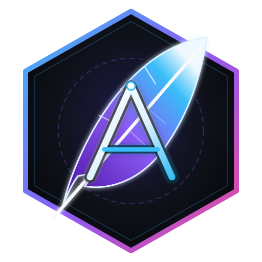

  

  <h1>AetherVault Studio v6.8 — Bluesky</h1>
  
<strong>100% Portable, Zero-Footprint Local AI, PC Workbench, AT Protocol Bridge &amp; Hardware Telemetry Workstation</strong>

  

    
    
    
    
    
  

  

    
    &nbsp;
    
  

  

    <a href="#features">Features</a>
    &nbsp;•&nbsp;
    <a href="#architecture">Modular Architecture</a>
    &nbsp;•&nbsp;
    <a href="#specpulse">SpecPulse</a>
    &nbsp;•&nbsp;
    <a href="#quick-start">Quick Start</a>
    &nbsp;•&nbsp;
    <a href="#console-commands">Console Commands</a>
    &nbsp;•&nbsp;
    <a href="#transparency">Privacy &amp; Transparency</a>
    &nbsp;•&nbsp;
    <a href="#license">License</a>
  

---

## ✨ Key Features (`v6.8 Bluesky`)

| Module | What It Does |
| :--- | :--- |
| **🧠 Model-Agnostic Zero-Drop Brain** | Runs local `.gguf` models (**Gemma 4 E4B** default for offline tools/environment, plus Qwen, Llama, Mistral, DeepSeek, Hermes &amp; Dolphin for coding, reasoning, or expressive roleplay) **or** routes through your own BYOK Cloud API waterfall (Google Gemini, Groq, Hugging Face Router, OpenRouter, DeepSeek, Mistral, OpenAI, LAN rigs) with automatic local failsafe &amp; Idle Sleep RAM/VRAM unloading. |
| **🛡️ Guardrail Blender &amp; Mode-Aware Polish** | Strips `<think>` echoes, leaked turn headers, and fake tool narration while preserving full expressive character voice in **Roleplay &amp; Lore Mode** and keeping **Assistant &amp; Workbench Mode** crisp, grounded, and Lore-free. |
| **🧭 Background Memory Compactor &amp; Mind-Map** | Deduplicates &amp; supersedes stale SQLite memories automatically in the background (`active = 1` filtering) and builds a 1-hop keyword co-occurrence mind-map to boost Knowledge Tree recall. |
| **🐍 Live Python Workbench &amp; Tool Registry** | In-process + killable subprocess execution (`vault.*`) backed by a unified `ToolRegistry` with alias resolution and **Safe Auto vs. Full PC** trust gating for file I/O, web/news search, live weather, Spotify, and OSWorld desktop control. |
| **🦋 Bluesky AT Protocol &amp; 📱 Telegram Bridges** | Publish posts and optionally auto-reply to mentions on Bluesky (`com.atproto.repo.createRecord` + Studio Settings card), or control your PC from anywhere with Telegram inline control panels &amp; Mini App support. |
| **🧩 Hot-Reload `custom_tools/`** | Drop in `.py` plugins—or let the model author, sandbox-test, and hot-reload its own permanent tools under `vault.plugins.*` without restarting the server. |
| **📊 SpecPulse Hardware Monitor** | Integrated 60-FPS visual hardware schematic, 64-bit VRAM telemetry, live waveforms, and built-in CPU/RAM/Storage benchmark suite. |
| **🔌 OpenAI `/v1` &amp; MCP Server** | Connects seamlessly to external tools (VS Code, Gemini CLI, scripts, remote clients) via `/v1/chat/completions`, `/v1/models`, and JSON-RPC 2.0 `/mcp`. |
| **🔄 Frozen 3-File Bootstrapper &amp; OTA Sync** | Distribute just 3 timeless bootstrapper files (`Launch.bat`, `Launch.sh`, `manager.py`). Dynamically detects runtime versions from `manifest.json`, auto-hydrates missing files, and applies SHA-256-verified runtime updates without overwriting your bootstrapper or personal data. |

---

* **🌐 Universal Multi-Language, Lore-Safe Spellcheck & Offline Argos Translate (`avs/language_tools.py`, `locales/`):** Instant 1-click **English / Español** Studio UI & Visual Manual switching (`locales/en.json`, `locales/es.json`), language-aware microphone recognition (`es-AR`, `en-US`, etc.), bilingual weather/Spotify/web routers, Lore-safe offline spell checking (`pyspellchecker` + `langid` auto-whitelisting your `glossary_index.json` and character names), and portable offline neural translation (`argostranslate` storing language packs in `models/translate/`).
* **📖 Stylized Visual Interactive Manual & 4-Page Illustrated PDF (`avs/manual_assets.py`, `AetherVault_Studio_Manual.pdf`):** Built-in bilingual (EN/ES) manual with inline vector SVG architecture diagrams, quick-jump section chips, and a matching 4-page vector-illustrated PDF manual.

## 🧱 Modular Architecture (`avs/`)

AetherVault Studio v6.8 separates its **frozen bootstrapper layer** (`Launch.bat`, `Launch.sh`, `manager.py`) from its **live runtime** (`assistant_server.py`, `ui_studio.html`, and the modular `avs/` package):

* **`avs/contracts.py`** — Shared dataclasses (`ToolSpec`, `ToolResult`) and bounded runtime limits (`MAX_ROUNDS`, `MAX_OBS_CHARS`).
* **`avs/memory_graph.py`** — Deterministic memory deduplication/superseding and bounded 1-hop `KeywordMindMap`.
* **`avs/referee.py`** — Lore attribution referee, reasoning-echo stripper, and abrupt-truncation detector.
* **`avs/tool_registry.py`** — Single-source-of-truth tool registry with alias resolution and `safe_auto` / `full_pc` trust gating.
* **`avs/bridges.py`** — Bluesky AT Protocol post/record formatting, Telegram message chunking, and inline control rows.
* **`avs/turn_pipeline.py`** — Bounded multi-round orchestration cap, observation compaction, and shared turn finalizer.
* **`avs/model_polish.py`** — Model-agnostic output normalizer and family sampling hints (`compact_general`, `expressive_chat`, `reasoning_model`, `code_model`, `cloud_endpoint`).
* **`avs/platform_bridge.py` / `avs/toolbox.py` / `avs/workbench.py` / `avs/hardware_monitor.py`** — Cross-platform OS/media/shell bridge, unified tool manifest, killable subprocess Python Workbench, and SpecPulse telemetry engine.

---

## 📊 SpecPulse :: Visual Hardware Telemetry &amp; Benchmark

Built directly into AetherVault Studio as a **zero-overhead on-demand overlay** (uses **0% CPU/GPU** when closed):

* **60-FPS Living Hardware Schematic:** Interactive PCB-style diagram showing real-time data flow between **CPU, RAM, GPU, Storage, and Motherboard**. Click any component block to inspect its full specs.
* **True 64-Bit GPU VRAM Reader:** Reads `HardwareInformation.qwMemorySize` directly from the Windows Registry to bypass the 4 GB 32-bit WMI `AdapterRAM` cap, alongside live GPU 3D/Compute load and dedicated VRAM usage.
* **Live Equalizer &amp; Waveforms:** Per-core CPU activity bars, real-time CPU &amp; Disk I/O waveforms, mounted partition usage, network throughput, and top memory processes.
* **Mini-Benchmark Reactor Suite:** Stress-tests Single-Core math, Multi-Core scaling, Memory bandwidth, and 128 MB Sequential Storage R/W (isolated inside `.temp_cache` with automatic cleanup).
* **How to Open:** Click **`📊 SpecPulse`** in the Studio sidebar (or on the Live SVG Hardware HUD card), pop it out at `/specpulse`, or run `/specs` in the Manager Console.

---

## 🚀 Quick Start (Windows, macOS &amp; Linux / Unix)

1. Download the **3-File Bootstrapper** (`Launch.bat`, `Launch.sh`, `manager.py`) from the [Releases Page](https://github.com/EnZeeeRu/AetherVault-Studio/releases) — or clone/download this repository directly.
2. Place the files into any folder you want as your portable studio home.
3. Launch using the command for your operating system:

| Platform | How to Start | Notes |
| :--- | :--- | :--- |
| **🪟 Windows** | Double-click **`Launch.bat`** | Auto-detects Python 3.10+ (or offers `winget` install) and opens the Bootstrapper &amp; Control Center. |
| **🍎 macOS** | Open Terminal in the folder and run: `chmod +x Launch.sh && ./Launch.sh` | Auto-detects Python 3.10+ (or offers `brew install python@3.11`) and launches `manager.py`. |
| **🐧 Linux / Unix** | Open Terminal in the folder and run: `chmod +x Launch.sh && ./Launch.sh` | Supports `apt`, `dnf`, `pacman`, and `zypper`. On headless servers or SSH, run `./Launch.sh --cli` for the terminal menu. |

4. Click **1. Launch AetherVault Server**—`manager.py` automatically hydrates any missing runtime files from GitHub (`manifest.json`), builds an isolated `.venv`, and opens the Studio UI in your browser (`http://127.0.0.1:8000` on desktop, `http://<LAN_IP>:8000` on home Wi-Fi).
5. Run the automated verification suite anytime via **`9. Run Automated Smoke Suite`** in the Bootstrapper or `python tests/smoke.py`.
6. Need the full guide? Grab the [AetherVault Studio Manual (PDF)](https://github.com/EnZeeeRu/AetherVault-Studio/raw/main/AetherVault_Studio_Manual.pdf) or click **📖 Manual** inside the app.

---

## 💻 Bootstrapper &amp; Web Terminal Console Commands

Type any of these directly into the **Bootstrapper Console** (`manager.py`), the **Studio Web Terminal** (`💻 Terminal`), or your linked **Telegram Bot**:

| Command | Action |
| :--- | :--- |
| `/help` | Show all available console commands |
| `/status` | Live model, GPU, RAM, workspace mode &amp; trust level |
| `/specs` | Deep SpecPulse hardware inventory (64-bit VRAM, CPU, live GPU load) |
| `/stop` | Immediately halt an active generation loop |
| `/unload` / `/wake` | Manually unload GGUF weights to free RAM/VRAM (Idle Sleep) or wake them back up |
| `/sleep [mins]` | Set Idle Sleep auto-unload timeout in minutes (`0` disables auto-sleep) |
| `/inject <cat> \| <fact>` | Save a fact directly into the Priority #1 SQLite Memory Vault |
| `/toggle <key> <val>` | Flip Studio toggles live (e.g. `/toggle workbench_trust full_pc`) |
| `/py <code>` | Execute Python in the killable subprocess Workbench |
| `/pip <package>` | Install any custom PyPI library into `.venv` |
| `/log [keyword] [lines]` | Tail `error_audit.log` locally (works offline) |
| `/telegram` | Check Telegram Bot Bridge connection &amp; active queue status |
| `/tunnel` | Show Home Wi-Fi LAN URL &amp; remote HTTPS tunnel instructions |
| `/update` | 1-click SHA-256 verified OTA runtime sync from `EnZeeeRu/AetherVault-Studio` |
| `/restart` | Cleanly stop &amp; relaunch `assistant_server.py` |

---

## 🛡️ Privacy, Transparency &amp; Disclaimer

AetherVault Studio is built to be **100% yours**.

* **Zero Telemetry &amp; No Phone-Home:** There are **no** analytics, tracking pixels, crash reporters, or hidden connections back to the creator (`EnZeeeRu`). Your chats, memories (`memory_core.db`), profile card, models, and custom tools stay strictly on your local machine.
* **Transparent Network Access:** The only outbound network requests the app ever makes are the ones **you** explicitly trigger or configure—such as downloading models from Hugging Face, running `/update` against this public GitHub repo, using live web/weather search, or connecting your own BYOK API keys / Spotify / Telegram / Bluesky. Flip **Offline Mode** ON in the Studio UI to cut all outbound network calls completely.
* **Your Environment, Your Rules:** Once downloaded, this workspace belongs entirely to you. Modify it, break it, extend it with `custom_tools/`, or run whatever local models you choose.
* **No Liability ("AS IS"):** Per the **MIT License**, this software is provided *"as is"*, without warranty of any kind. The creator (`EnZeeeRu`) assumes **no responsibility or liability** for any outputs generated by AI models, code executed in the Python Workbench, desktop actions performed via OSWorld, or any other use or misuse of this software. You are solely responsible for what you run and build with it.

---

## 📜 License &amp; Attribution

* **Source Code:** Licensed under the **[MIT License](LICENSE)**.
* **Branding, Artwork (`aethervault_logo.svg`), Manual PDF &amp; Documentation:** Licensed under **[Creative Commons Attribution-NonCommercial 4.0 International (CC BY-NC 4.0)](https://creativecommons.org/licenses/by-nc/4.0/)** — credit **Enzeru (`EnZeeeRu`)**; non-commercial use only.
* **Third-Party Packages &amp; Models:** All Python libraries, APIs, and downloaded `.gguf` weights remain the property of their respective authors and license holders.

  Made with ❤️ in Argentina by <strong>Enzeru</strong>, in collaboration with Google Gemini.

